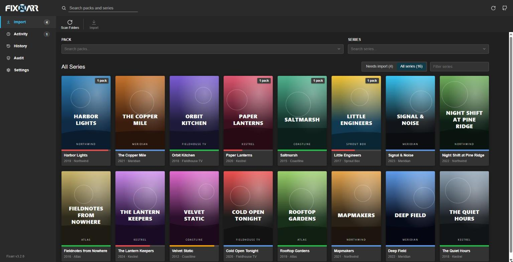
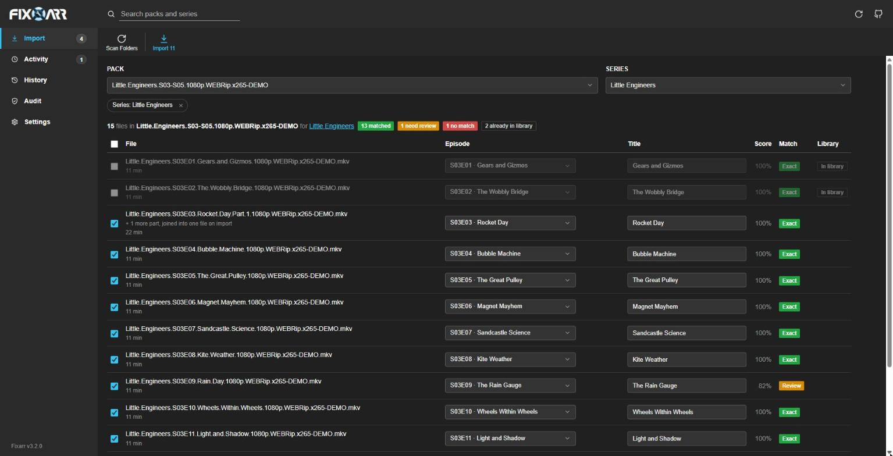
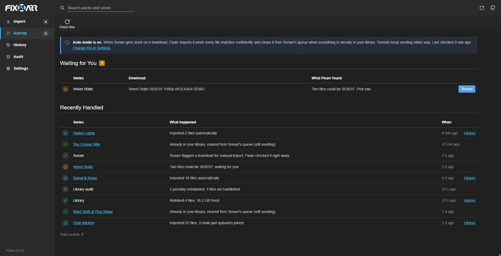
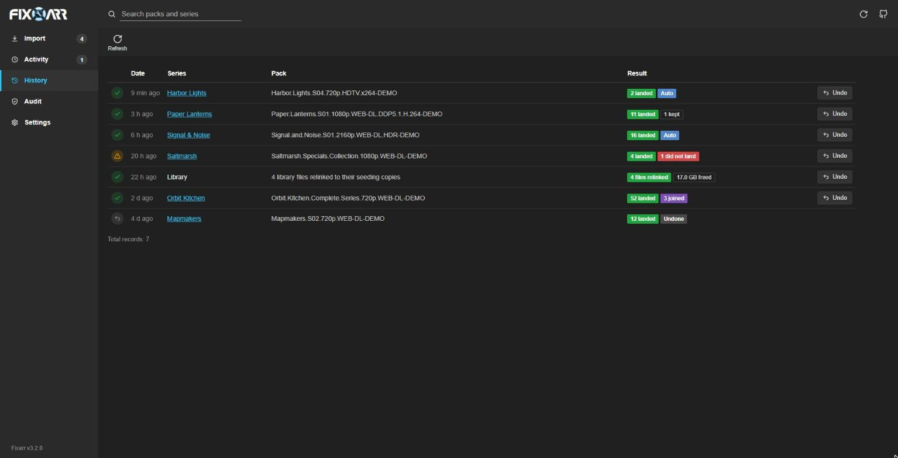
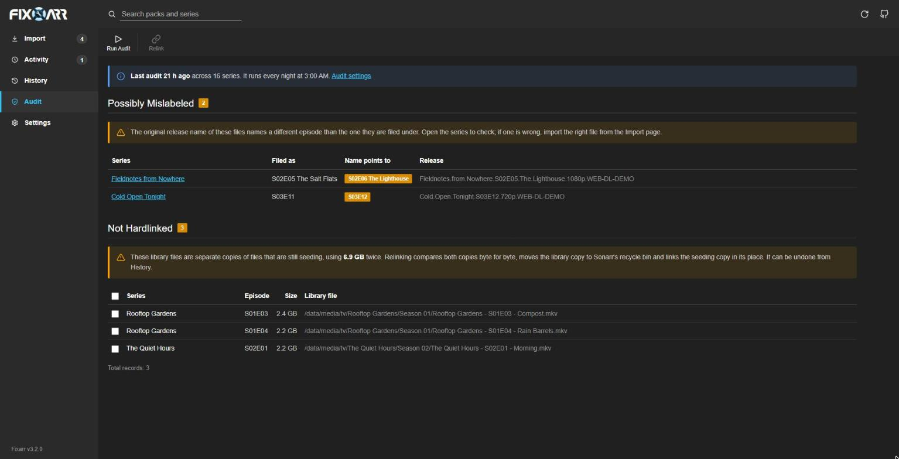
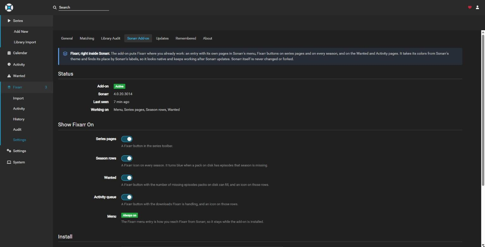
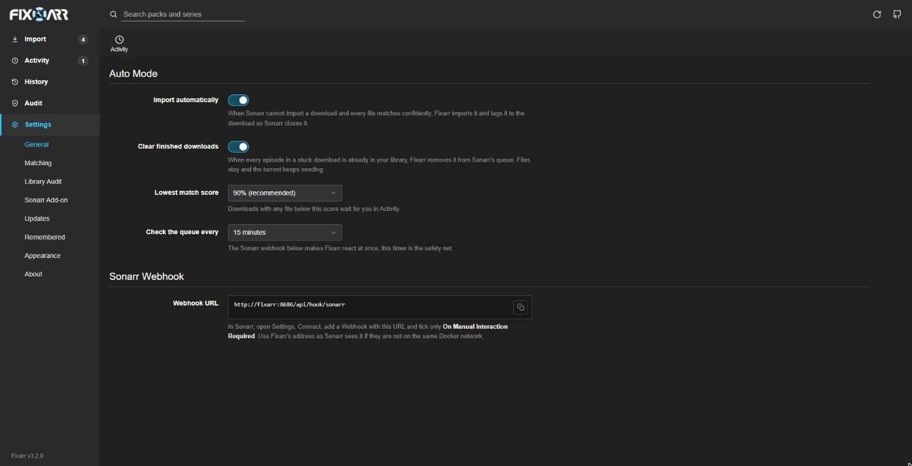

<div align="center">


# Fixarr

**Import the season packs Sonarr can't.**

A self-hosted Sonarr companion that matches messy season packs, joins multi-part episodes, clears Sonarr's stuck import queue and lives right inside Sonarr's own UI.

[](https://github.com/Apex-Tech-Labs/fixarr/releases)
[](https://github.com/Apex-Tech-Labs/fixarr/actions/workflows/docker.yml)
[](https://github.com/Apex-Tech-Labs/fixarr/pkgs/container/fixarr)
[](https://sonarr.tv)
[](LICENSE)

[Features](#features) · [Screenshots](#screenshots) · [Quick start](#quick-start) · [Sonarr add-on](#the-sonarr-add-on) · [FAQ](#faq)



</div>

---

## Why Fixarr?

Sonarr is great at single episodes. Season packs, full-series packs and oddly named releases are where it gives up:

- `Unable to identify correct episode(s) using release name and scene mappings`
- `Download - Unable to import automatically`
- Downloads parked in **Activity > Queue** with the orange **Manual Interaction Required** icon
- Full-series packs, obfuscated file names and episodes split into parts that Sonarr can't parse at all

The usual fix is Sonarr's **Wanted > Manual Import > Interactive Import**, picking episodes row by row. Fixarr does that work for you. It matches every file by **title as well as number**, so it handles wrong numbering, DVD orders, specials and split episodes. It imports through Sonarr's own API, so Sonarr stays the source of truth. And it checks afterwards that each episode really landed.

## Features

### Smart season pack matching
- **Title matching, not just `S01E01`.** Works through wrong numbering, multi-season and full-series packs, DVD and broadcast orders, and episodes Sonarr only knows by name.
- **Specials that make sense.** "Season 5 Reunion" or "S06E14 Reunion" goes to the right Season 00 special.
- **Multi-part episodes joined losslessly.** Splits like `E01a`/`E01b`, `Part 1`/`Part 2`, `Pt.One`, `CD1`/`CD2`, `Disc 1` and `1 of 2` are joined into one MKV with mkvmerge. Two-part *stories* that Sonarr lists as separate episodes stay separate.
- **Runtime check.** A file far shorter or longer than the series' episodes is flagged for a look.
- **Remembers your corrections.** Fix a match once and Fixarr reuses it for that file name.

### Safe imports
- **Hardlinks, not copies.** Your torrents keep seeding in qBittorrent, Deluge or Transmission, and no extra space is used.
- **Verified.** An episode counts as imported only when Sonarr's library file is the exact file Fixarr handed over. Every file ends up "landed", "kept the library's file" or "did not land", each with a reason.
- **History with undo.** Replaced files go to Sonarr's recycle bin and come back on undo.

### Auto mode for Sonarr's stuck queue
- **Clears finished downloads.** When everything in a stuck download is already in your library, Fixarr removes it from Sonarr's queue. The torrent keeps seeding.
- **Imports confident matches.** When every file matches above your score, Fixarr imports it and tags it to the download so Sonarr closes it.
- **Waits for you on the rest.** Anything uncertain shows up in **Activity > Waiting for You**.
- **Reacts instantly.** Sonarr's *On Manual Interaction Required* webhook triggers it, with a timer as a safety net.

### Library audit
- **Possibly mislabeled episodes.** Finds files whose original release name points at a different episode than the one they are filed under.
- **Not hardlinked.** Finds library files that are separate copies of files still seeding, and relinks them after a byte-for-byte check. Space comes back, seeding keeps going.

### Feels like Sonarr
- **A Sonarr-style web app.** Left menu, page toolbars, poster grids, Sonarr's dark and light themes, plus a few of its own.
- **An optional Sonarr add-on.** Fixarr appears *inside Sonarr*: a menu entry with its own pages, buttons on series pages and on every season, and on the Wanted and Queue pages. Sonarr itself is never forked or patched.

## Screenshots

| | |
|---|---|
|  |  |
| **Import.** Every file in a pack gets an episode, a score and a reason. Split parts are joined, uncertain ones wait for review. | **Activity.** What auto mode did with Sonarr's stuck queue, and what is waiting for you. |
|  |  |
| **History.** Every import and relink, with Undo. | **Audit.** Mislabeled episodes and files that should be hardlinks. |
|  |  |
| **Inside Sonarr.** The add-on gives Fixarr a menu entry and pages of its own in Sonarr. | **Settings.** Auto mode, matching, audit, add-on and updates, each on its own page. |

All screenshots use Fixarr's built-in demo data. Open `http://your-server:8686/?demo` to click through it yourself.

## Quick start

**You need:**
- **Sonarr v4.** The v5 beta works too.
- **Docker with Docker Compose.**
- **One shared `/data` folder.** Fixarr must see the same `/data` folder as Sonarr and your download client. Hardlinks only work inside one filesystem, so use the single `/data` layout from the [TRaSH Guides](https://trash-guides.info/File-and-Folder-Structure/).
- **Sonarr's recycle bin (recommended).** Undo and relink need it. Turn it on in Sonarr under Settings > Media Management.

**1. Create a folder for Fixarr's settings,** so it belongs to your user and not root:

```sh
mkdir -p ./fixarr
```

**2. Add Fixarr to your `docker-compose.yml`,** next to Sonarr:

```yaml
services:
  fixarr:
    image: ghcr.io/apex-tech-labs/fixarr:latest
    container_name: fixarr
    user: 1000:1000                      # the same user Sonarr runs as
    environment:
      - SONARR_URL=http://sonarr:8989
      - SONARR_API_KEY=your-sonarr-api-key
      - SCAN_DIRS=/data/torrents/tv       # folders that hold TV packs (comma-separated)
      - TZ=Etc/UTC
    volumes:
      - ./fixarr:/config
      - /path/to/data:/data               # the SAME host folder Sonarr mounts as /data
    ports:
      - 8686:8686
    restart: unless-stopped
```

Sonarr's API key is under Settings > General in Sonarr. Every option is in [`docker-compose.example.yml`](docker-compose.example.yml).

**3. Start it** with `docker compose up -d`, then open `http://your-server:8686`.

**4. Connect the Sonarr webhook,** so auto mode reacts the moment Sonarr gets stuck:
1. In Sonarr, open Settings > Connect > + > Webhook.
2. Set the URL to `http://fixarr:8686/api/hook/sonarr`.
3. Tick only **On Manual Interaction Required**.

Without the webhook, Fixarr still checks the queue every 15 minutes.

## The Sonarr add-on

The add-on is optional and comes in the same container. It puts Fixarr inside Sonarr:

- **A Fixarr menu entry** with its own pages at `/addons/fixarr/...`.
- **Buttons where you need them:** on series pages, on every season row, and on the Wanted and Queue pages.
- **Sonarr's own look.** It takes its colors from Sonarr's theme.
- **Survives updates.** It finds its place by Sonarr's labels, not its generated class names, so it keeps working after Sonarr updates.
- **Always current.** Each build is stamped, and a copy served from a stale cache reloads itself.
- **Easy to tailor.** Switch each placement on or off under **Settings > Sonarr Add-on**.

Fixarr's **Settings > Sonarr Add-on** page shows these snippets with copy buttons and tells you once the add-on is working. Pick one way:

### A. Reverse proxy (recommended)

Serve Fixarr under `/fixarr/` on Sonarr's address and add one script tag to Sonarr's page.

**Nginx or Nginx Proxy Manager** (Advanced tab of the Sonarr proxy host):

```nginx
location ^~ /fixarr/ {
    proxy_pass http://fixarr:8686/;
    proxy_read_timeout 300s;
}
sub_filter '</head>' '<script defer src="/fixarr/layer.js"></script></head>';
sub_filter_once on;
proxy_set_header Accept-Encoding "";
```

Protect `/fixarr/` with the same login as the rest of Sonarr.

**Caddy, Traefik or SWAG:** same idea. Send `/fixarr/*` to the container with the prefix removed, and add the script tag to Sonarr's HTML.

### B. Userscript (no proxy changes)

1. On the Fixarr container, set `CORS_ORIGINS` to your Sonarr address, for example `CORS_ORIGINS=https://sonarr.example.com`.
2. Install a userscript manager in your browser: Violentmonkey or Tampermonkey.
3. Open `http://your-server:8686/fixarr.user.js?sonarr=https://sonarr.example.com` and accept the install.

The add-on then shows in every browser where the userscript is installed.

## Configuration

| Variable | Default | Meaning |
|---|---|---|
| `SONARR_URL` | `http://sonarr:8989` | How Fixarr reaches Sonarr |
| `SONARR_API_KEY` | | Sonarr's API key |
| `SONARR_PUBLIC_URL` | | Sonarr's address in your browser, for links from the web app to Sonarr |
| `SCAN_DIRS` | `/data/torrents/tv` | Comma-separated folders holding packs |
| `DATA_ROOT` | `/data` | Root of the shared data folder |
| `TORRENTS_ROOT` | `$DATA_ROOT/torrents` | Fixarr only reads and links packs under this folder |
| `STATE_DIR` | `/config` | Settings, history and remembered matches |
| `PLEX_URL`, `PLEX_TOKEN` | | Optional: a Plex scan for specials Fixarr places in Season 00 |
| `PLEX_PATH_MAP` | | `container=plex` path pairs when Plex sees the library under another path, e.g. `/data=/mnt/storage/data` |
| `CORS_ORIGINS` | | Sonarr addresses allowed to call Fixarr (userscript install only) |
| `FIXARR_SCHEDULER` | `1` | `0` turns off auto mode, the catalog refresh and the nightly audit |

Everything else lives in **Settings** inside Fixarr: auto mode, match score, runtime check, nightly audit, the Sonarr add-on, updates and appearance.

## Updates

Turn these on or off in **Settings > Updates**:

- **Update check.** Fixarr looks for a new GitHub release once a day and shows "Update available" in the header. Nothing else is sent.
- **Channel.** **Stable** gets finished releases. **Beta** also gets test releases before they are finished.
- **Installing updates.** A container can't replace itself, so let your container updater do it. With [Watchtower](https://github.com/nicholas-fedor/watchtower), Fixarr updates itself whenever a new image is published.

| Image tag | Follows |
|---|---|
| `latest` | Every stable release (recommended) |
| `beta` | Every beta release (what the Beta channel installs) |
| `edge` | The main branch, for testing |
| `3.2.0` (any version) | That exact release, never updated |

Major releases (for example 3.x to 4.0) are announced in Fixarr before you install them, and they move your settings forward on their own.

## FAQ

<details>
<summary><b>Sonarr says "Unable to identify correct episode(s) using release name and scene mappings". Can Fixarr import it?</b></summary>

Yes, that is the main thing it is for. Pick the pack on Fixarr's Import page, or click the Fixarr icon on the season in Sonarr. Fixarr matches each file by title and number, shows you the result with a score, and imports it through Sonarr.
</details>

<details>
<summary><b>How do I clear "Manual Interaction Required" downloads from Sonarr's queue?</b></summary>

Turn on auto mode in **Settings > General** and add the Sonarr webhook. When every episode of a stuck download is already in your library, Fixarr removes it from Sonarr's queue without deleting files or blocklisting the release, so the torrent keeps seeding. When every file matches confidently, it imports it instead.
</details>

<details>
<summary><b>Does Fixarr move or delete my downloads?</b></summary>

No. It reads packs under `TORRENTS_ROOT` and hardlinks the files it imports, so the originals stay where your download client expects them. Your library only changes through Sonarr's API, and anything Sonarr replaces goes to its recycle bin.
</details>

<details>
<summary><b>Does it work with Plex, Jellyfin and Emby?</b></summary>

Yes. Fixarr imports into Sonarr's normal library folders, and joined episodes are standard MKV files. Specials it places in Season 00 can trigger a Plex scan if you set `PLEX_URL` and `PLEX_TOKEN`; Jellyfin and Emby pick them up on their own library scan.
</details>

<details>
<summary><b>Is this a Sonarr fork?</b></summary>

No. Fixarr is a separate container that talks to Sonarr's API. The optional add-on adds Fixarr to Sonarr's pages in your browser and never changes Sonarr's code or database.
</details>

<details>
<summary><b>Which file formats can be joined?</b></summary>

Parts are joined losslessly with [mkvmerge](https://mkvtoolnix.download/) into one MKV, which Sonarr, Plex, Jellyfin and Emby all play.

- **Supported part formats:** MKV, MP4, M4V, MOV, AVI, MPG, VOB and TS.
- **WMV parts can't be joined.** Import part 1 on its own instead.
- **Codecs must match.** All parts of one episode need the same video and audio codecs, which is normal for split releases.
</details>

<details>
<summary><b>Does it support Radarr?</b></summary>

Not today. Fixarr is built around TV: seasons, specials and multi-part episodes. See the [roadmap](ROADMAP.md) for what is planned.
</details>

## Security

Fixarr has no login of its own. Anyone who can reach port 8686 can import into your Sonarr, so keep it on your LAN or VPN, or behind the same login as Sonarr.

Fixarr only reads and links files under `TORRENTS_ROOT`. It only changes your library through Sonarr's API.

## Development

```sh
pip install -r requirements.txt
python3 tests/units.py        # matcher unit checks
python3 tests/regression.py   # synthetic regression: made-up shows covering every naming situation
sh static/build.sh            # rebuilds static/layer.js from static/src
SONARR_URL=... SONARR_API_KEY=... FIXARR_SCHEDULER=0 python3 app.py
```

Open `http://localhost:8686/?demo` to work on the UI without a Sonarr.

## Roadmap

See [ROADMAP.md](ROADMAP.md). A native Windows app is planned.

## License

GNU General Public License v3.0. See [LICENSE](LICENSE).

Fixarr is an independent project by [Apex Tech Labs](https://github.com/Apex-Tech-Labs). It is not affiliated with Sonarr, Plex, Jellyfin or Emby.
